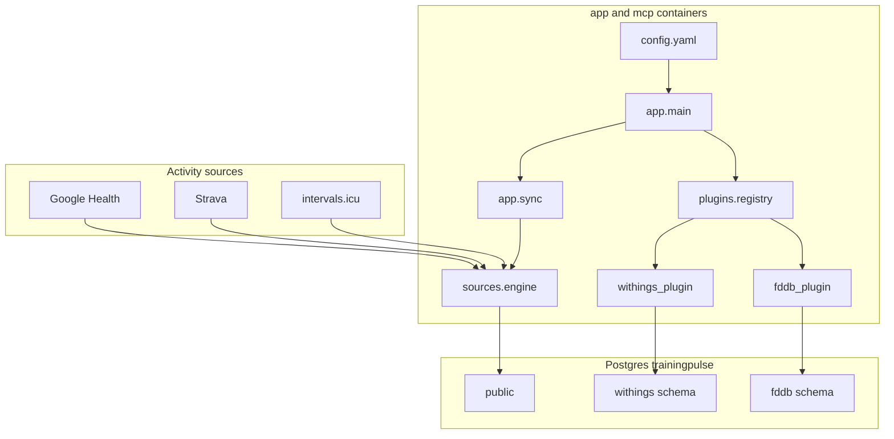

# Developer notes

Technical reference for **TrainingPulse**. Day-to-day setup lives in [`README.md`](README.md); this file covers architecture, provider APIs, the HTTP API, the configuration schema, and how training metrics are calculated.

## Architecture

```
intervals.icu API  ─┐
Strava API         ─┼→ [app/ FastAPI core] → PostgreSQL (trainingpulse)
Google Health API  ─┘
Optional plugins (withings, fddb) → PostgreSQL schemas `withings`, `fddb`
Grafana → provisioned Postgres datasource
MCP → same database as core (+ plugin schemas when enabled)
```

The core service in [`app/`](app/) handles source authentication, APScheduler, TRIMP/CTL/ATL/TSB, and the status UI. Optional plugins under [`plugins/`](plugins/) are loaded in-process via [`app/plugins/registry.py`](app/plugins/registry.py).

Shared helpers, including the configuration loader, live in [`packages/trainingpulse_common/`](packages/trainingpulse_common/).



### Plugin HTTP routes

| Plugin | Prefix | Notes |
|--------|--------|-------|
| Withings | `/plugins/withings` | OAuth at `/auth/withings`, callback `/get_token` |
| FDDB | `/plugins/fddb` | Cookie-based scrape; no OAuth |

## Activity sources

Activity primary keys are **strings** with a source prefix:

- `icu_<intervalsId>` — e.g. `icu_i55610271`
- `strava_<stravaId>` — e.g. `strava_1122334455`
- `ghealth_<dataPointId>` — Google Health exercise resource id

Column `activities.source` is `icu`, `strava`, or `google_health`. Prefixing is idempotent, so ids preserved across earlier migrations map back onto themselves.

### The source contract

Each source is an adapter implementing the `ActivitySource` protocol in [`app/sources/base.py`](app/sources/base.py). A source knows only how to authenticate, list a date window, fetch one activity's detail and streams, and map a provider payload onto `activities` columns. Backfill, incremental sync, reconciliation, queue draining, concurrency, rate-limit pausing, and supersession all live once in [`app/sources/engine.py`](app/sources/engine.py).

| Member | Purpose |
|--------|---------|
| `name`, `id_prefix` | Value stored in `activities.source` and the id prefix |
| `supports_detail` | False when the list payload is already complete (Google Health) |
| `supports_streams` | False when the provider has no time series |
| `supports_reconcile` | False when re-listing a recent window is too expensive |
| `requires_authorization` | True for OAuth sources; drives the status-page Connect button |
| `connect_path` / `disconnect_path` | Routes mounted by `register_auth_routes` |
| `is_configured()` / `is_connected()` | Credentials present / usable right now |
| `verify_credentials()` | Fail-fast auth check; returns a provider athlete id. **Never** used for zones or FTP |
| `list_activities(start, end)` | Provider payloads for a half-open window; the source owns its own pagination |
| `fetch_detail(external_id)` | One activity's detail; `None` means gone upstream |
| `fetch_streams(activity)` | Canonical `{stream: [samples]}` |
| `map_row(payload, athlete_id)` | **Pure and synchronous** — provider payload to column dict |
| `rate_limits()` | Quota snapshot for the status page |

### Adding an activity source

1. Write `app/sources/<name>.py` with a module-level `map_row` and stream normalizer, both pure so they can be tested against recorded payloads, plus a class implementing the protocol.
2. Keep anything async out of `map_row`. If the provider needs a second call to complete a row (Strava resolves gear names this way), do it in `fetch_detail` and return an augmented payload.
3. Add a config section in `packages/trainingpulse_common/trainingpulse_common/config.py`: a model with `enabled`, credentials marked with `secret()`, `is_configured()`, and `missing_credentials()`. Add the name to `SOURCE_NAMES` — its position there is the default precedence.
4. Register a builder in [`app/sources/registry.py`](app/sources/registry.py).
5. Add a label in `SOURCE_LABELS` in [`app/main.py`](app/main.py).
6. Add fixtures to `app/tests/fixtures/payloads.py` and mapper tests. `test_mappers_agree_on_the_column_set` will fail until the new mapper emits exactly the same columns as the others.

### intervals.icu

| Method | Endpoint | Role |
|--------|----------|------|
| List | `GET /api/v1/athlete/0/activities?oldest=&newest=` | Date-window list / backfill |
| Detail | `GET /api/v1/activity/{id}` | Merge notes, calories, gear |
| Streams | `GET /api/v1/activity/{id}/streams.json` | HR / power / GPS |
| Athlete | `GET /api/v1/athlete/0` | Credential check and athlete id only |

Auth: Basic, username `API_KEY`, password = personal API key. Rate limits ~2500 / 15 min and 5000 / day. A browser-like `User-Agent` is **required** (Cloudflare).

Sport-settings are deliberately not requested; see [HR and FTP](#hr-and-ftp).

### Strava

| Method | Endpoint | Role |
|--------|----------|------|
| List | `GET /athlete/activities?after=&before=&per_page=200` | Paged window list |
| Detail | `GET /activities/{id}` | Description, calories, device, suffer score |
| Gear | `GET /gear/{id}` | Display name; cached per client |
| Streams | `GET /activities/{id}/streams?key_by_type=true` | HR / power / GPS |
| Athlete | `GET /athlete` | Credential check and athlete id only |

Auth: OAuth, scopes `activity:read_all,profile:read_all`. Tokens live in `oauth_tokens` (`provider=strava`), refreshed automatically. Callback is `{app.base_url}/auth/strava/callback`.

Strava publishes **two** budgets per response: `X-RateLimit-*` (overall) and `X-ReadRateLimit-*` (reads only), defaulting to 200/2000 and 100/1000. Almost every call here is a read, so the client gates on whichever budget is closer to its limit. The 15-minute window resets on the quarter hour; the client sleeps until then, and a daily exhaustion raises `SourceRateLimitExceeded` so the phase resumes next sync.

`suffer_score` is Strava's relative effort and is NULL for every other source.

### Google Health

| Data | Endpoint | Role |
|------|----------|------|
| Exercises | `GET .../dataTypes/exercise/dataPoints` | Sessions, complete in the list payload |
| Heart rate | `GET .../dataTypes/heart-rate/dataPoints` | Streams for TRIMP |

Auth: Google OAuth (`access_type=offline`). Tokens in `oauth_tokens` (`provider=google_health`). For personal apps set the OAuth consent screen to **In production** (can stay unverified) to avoid Testing-mode 7-day refresh expiry.

`supports_detail` is False (the list payload is complete) and `supports_reconcile` is False, because Google Health publishes no per-activity update marker worth re-listing for. Google publishes no usable quota headers, so `rate_limits()` reports `known: false` rather than a misleading 0/0.

## Source precedence and supersession

A run is two-pass, and the ordering is load-bearing:

1. **List** — each enabled source, in precedence order, lists its window and upserts summary rows.
2. **Supersede** — `recompute_supersessions` recomputes `superseded_by` across *every* stored row.
3. **Enrich** — each source drains its detail and stream queues, filtered to `superseded_by IS NULL`.
4. **Supersede again** — detail can change `elapsed_time`, which can change what overlaps. Idempotent.
5. **Derive** — estimated FTP, power curves, daily CTL/ATL/TSB.

Two activities compete when their starts are within `START_TOLERANCE_SECONDS` (900) **and** their time ranges genuinely overlap. The winner is decided by `(precedence index, longer duration, earlier start, id)`. Comparison is pairwise rather than transitive, so a chain of near-misses cannot collapse two activities that do not actually overlap; winner chains are then resolved to their root so `superseded_by` always points at a visible row.

`choose_winners` in [`app/sources/engine.py`](app/sources/engine.py) is a pure function over `(id, source, start, elapsed)` tuples and is tested directly.

Two properties worth preserving:

- **Precedence is positional and ignores `enabled`.** Preserved `strava` rows must keep outranking Google Health after Strava is disabled, or reordering the list silently rewrites history. A startup warning fires when a disabled source outranks an enabled one.
- **Losers are stored, not dropped.** That is what makes reordering `sources.precedence` reversible without a re-backfill. Hidden rows never spend detail or stream calls.

The `active_activities` view (`superseded_by IS NULL`) is what Grafana reads. It is dropped and recreated on migration rather than replaced, because `CREATE OR REPLACE VIEW` can only append columns to a `SELECT *` view.

## HTTP API

| Method | Endpoint | Description |
|--------|----------|-------------|
| `GET`  | `/` | Status page with sources, sync progress, metrics |
| `GET`  | `/auth/strava` | Start Strava OAuth |
| `GET`  | `/auth/strava/callback` | OAuth redirect; stores tokens |
| `POST` | `/auth/strava/disconnect` | Remove Strava tokens |
| `GET`  | `/auth/google` | Start Google Health OAuth |
| `GET`  | `/auth/google/callback` | OAuth redirect; stores tokens |
| `POST` | `/auth/google/disconnect` | Remove Google Health tokens |
| `GET`  | `/sync/status` | JSON sync status, including per-source quota |
| `POST` | `/sync/trigger` | Incremental sync |
| `POST` | `/sync/full` | Full historical resync |
| `POST` | `/sync/refresh-rate-limit` | Refresh each connected source's quota headers |

OAuth routes are mounted by the sources themselves via `register_auth_routes`, not hardcoded in `app/main.py`. The Google paths are fixed strings because they are already registered in users' Google Cloud OAuth clients.

## Configuration

All application settings come from a single YAML file. The schema, loader, and validation live in [`packages/trainingpulse_common/trainingpulse_common/config.py`](packages/trainingpulse_common/trainingpulse_common/config.py); [`app/config.py`](app/config.py) loads it once at import and exits non-zero with a readable message if anything is wrong.

`config.example.yaml` is the reference. Sections: `app`, `database`, `athlete`, `sources`, `sync`, `mcp`, `plugins`.

### Where the file comes from

`$TP_CONFIG_FILE` → `/config/config.yaml` → `./config.yaml`. A missing file is a hard error; `athlete.*` is required, so there is no useful zero-config boot.

### Two environment mechanisms

These are independent and easy to confuse:

1. **Structural overrides** — `TP_<SECTION>__<KEY>`, double underscore for nesting, applied to the parsed document before validation. Lists accept a comma-separated string (`TP_SOURCES__PRECEDENCE=icu,strava`); booleans accept `1/true/yes/on` and their negatives. An unknown `TP_*` name is an error naming the variable, not a silent no-op.
2. **Value interpolation** — `${VAR}` or `${VAR:-default}` *inside* a YAML string value, expanded textually before validation. These names are user-chosen and carry no `TP_` prefix. An unset `${VAR}` with no default becomes an empty string and logs a warning; the enabled-without-credentials check then reports it properly.

Precedence is **env override > YAML value > built-in default**.

### Validation

Models use `extra="forbid"`, so a typo is a hard error rather than a silently ignored key. Every problem — unknown keys, wrong types, missing required values, unknown source names in `precedence`, a source or plugin enabled with blank credentials — is collected and reported in one message, then the process exits non-zero.

On startup the effective configuration is logged at INFO with every field marked `secret()` masked. `test_every_sensitive_looking_field_is_marked_secret` fails if a new credential field is added without that marker.

### Compose-level variables

`POSTGRES_USER` / `POSTGRES_PASSWORD` / `POSTGRES_DB` stay in `.env`: the `db` container and Grafana's `datasource.yml` need them as environment variables. Compose composes `TP_DATABASE__URL` from them so the connection string is not duplicated in `config.yaml`. `MCP_PORT` in `.env` is only the published host port; the container always listens on `mcp.port`.

## HR and FTP

`athlete.max_hr`, `athlete.rest_hr`, and `athlete.ftp` are **required** and have no defaults. No provider profile, sport-settings, or zone endpoint is ever called, so `athlete_settings.hr_zones` stays NULL and `get_hr_zone_boundaries` always computes percentage-based zones from `max_hr` and `rest_hr`.

`athlete_settings.estimated_ftp` is still derived locally as 95% of the best 20-minute power across visible activities; it is a computed value, not configuration.

Changing any athlete value requires a full resync to recalculate history.

## Schema upgrades

On startup [`app/schema_migrate.py`](app/schema_migrate.py) migrates **in place and preserves all activity history**:

- Strava-era bigint `activities.id` becomes `VARCHAR(128)` and is prefixed `strava_`; `activity_streams.activity_id` is migrated and re-prefixed to match, not dropped.
- `strava_detail_synced` → `detail_synced`, `strava_updated_at` → `provider_updated_at`; `source` and `superseded_by` are added.
- `suffer_score` is re-added if missing, and in the same guarded branch preserved `strava` rows are re-queued for a detail fetch. Streams are deliberately left alone because the earlier migration kept them, and refetching them would waste Strava's read budget. The guard is the column's absence, so this runs exactly once per database.
- `strava_tokens` is dropped; Strava OAuth lives in `oauth_tokens` now, so Strava must be reconnected once.
- Short-lived `fitbit` labels are renamed to `google_health`, including the `fitbit_` id prefix.

## Training metrics reference

Computed in [`app/metrics.py`](app/metrics.py) and stored alongside activities and in `daily_metrics`. Aggregates exclude superseded activities.

| Metric | Also known as | Description |
|--------|---------------|-------------|
| TRIMP | Training Impulse | Banister-style load from HR streams (or sport estimate without HR) |
| CTL | Fitness | 42-day EMA of daily TRIMP |
| ATL | Fatigue | 7-day EMA of daily TRIMP |
| TSB | Form | CTL − ATL |
| Estimated FTP | — | 95% of best 20-minute power across activities |

## MCP

The `mcp` Compose service runs [`app/mcp_server.py`](app/mcp_server.py) at `http://your-host:${MCP_PORT:-8001}/mcp`. Read-only; does not expose `oauth_tokens` or credentials. Activity ids are strings (`icu_…` / `strava_…` / `ghealth_…`).

Every aggregate filters `superseded_by IS NULL` via `_apply_activity_filters`, so duplicated activities are not double-counted. `get_activity_detail` still resolves a hidden duplicate when asked for it by id, and reports `superseded_by` so the caller can tell.

The mcp container mounts the same `config.yaml` as the app. If you would rather it not see source and plugin credentials, point its `TP_CONFIG_FILE` at a reduced file — it only needs `mcp.*`, `database.url`, and `plugins.*.enabled`.

## Tests

```bash
docker compose exec app python -m pytest tests -q
```

- `tests/test_config_loader.py` — loader, overrides, interpolation, validation, redaction
- `tests/test_source_mappers.py` — per-source mappers and stream normalizers against `tests/fixtures/payloads.py`, plus protocol conformance
- `tests/test_engine.py` — `choose_winners` precedence and overlap rules, date windows, reconcile diffing

## Demo data

[`app/seed_demo_data.py`](app/seed_demo_data.py) seeds synthetic `icu_` / `strava_` / `ghealth_` activities for Grafana screenshots (athlete `99999999`), including overlapping duplicates so the supersession path is exercised. OAuth token tables are never touched.

```bash
docker compose exec app python seed_demo_data.py --force
```

## Source map

- Status UI, route mounting, scheduler: [`app/main.py`](app/main.py)
- Sync ordering: [`app/sync.py`](app/sync.py)
- Source contract: [`app/sources/base.py`](app/sources/base.py)
- Generic phases, precedence, supersession: [`app/sources/engine.py`](app/sources/engine.py)
- Source adapters: [`app/sources/intervals.py`](app/sources/intervals.py), [`app/sources/strava.py`](app/sources/strava.py), [`app/sources/google_health.py`](app/sources/google_health.py)
- Source construction from config: [`app/sources/registry.py`](app/sources/registry.py)
- Provider HTTP clients: [`app/intervals_client.py`](app/intervals_client.py), [`app/strava_client.py`](app/strava_client.py), [`app/google_health_client.py`](app/google_health_client.py)
- Schema migration (in place, history preserved): [`app/schema_migrate.py`](app/schema_migrate.py)
- Metrics: [`app/metrics.py`](app/metrics.py)
- Models: [`app/models.py`](app/models.py)
- Config schema and loader: [`packages/trainingpulse_common/trainingpulse_common/config.py`](packages/trainingpulse_common/trainingpulse_common/config.py), [`app/config.py`](app/config.py)
- MCP: [`app/mcp_server.py`](app/mcp_server.py)
- Grafana: [`grafana/`](grafana/)
- Plugins: [`app/plugins/registry.py`](app/plugins/registry.py), [`plugins/`](plugins/)
