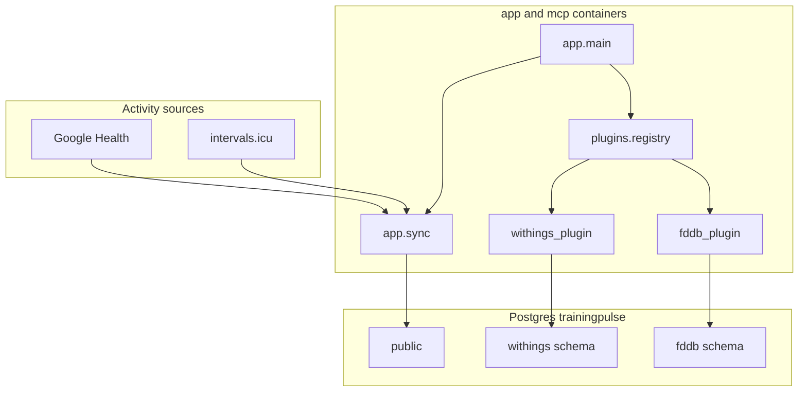

# Developer notes

Technical reference for **TrainingPulse**. Day-to-day setup lives in [`README.md`](README.md); this file covers architecture, provider APIs, the HTTP API, environment variables, and how training metrics are calculated.

## Architecture

```
intervals.icu API  ─┐
Google Health API  ─┴→ [app/ FastAPI core] → PostgreSQL (trainingpulse)
Optional plugins (withings, fddb) → PostgreSQL schemas `withings`, `fddb`
Grafana → provisioned Postgres datasource
MCP → same database as core (+ plugin schemas when enabled)
```

The core service in [`app/`](app/) handles intervals.icu API-key sync, Google Health OAuth, APScheduler, TRIMP/CTL/ATL/TSB, and the status UI. Optional plugins under [`plugins/`](plugins/) are loaded in-process via [`app/plugins/registry.py`](app/plugins/registry.py).

Shared helpers live in [`packages/trainingpulse_common/`](packages/trainingpulse_common/).



### Plugin HTTP routes

| Plugin | Prefix | Notes |
|--------|--------|-------|
| Withings | `/plugins/withings` | OAuth at `/auth/withings`, callback `/get_token` |
| FDDB | `/plugins/fddb` | Cookie-based scrape; no OAuth |

## Activity providers

Activity primary keys are **strings** with a provider prefix:

- `icu_<intervalsId>` — e.g. `icu_i55610271`
- `ghealth_<dataPointId>` — Google Health exercise resource id

Column `activities.source` is `icu` or `google_health`.

### intervals.icu

| Method | Endpoint | Role |
|--------|----------|------|
| List | `GET /api/v1/athlete/0/activities?oldest=&newest=` | Date-window list / backfill |
| Detail | `GET /api/v1/activity/{id}` | Merge notes, calories, gear |
| Streams | `GET /api/v1/activity/{id}/streams.json` | HR / power / GPS |
| Athlete | `GET /api/v1/athlete/0` | Profile |
| Sport settings | `GET /api/v1/athlete/0/sport-settings` | FTP / HR zones |

Auth: Basic username `API_KEY`, password = personal API key. Rate limits ~2500 / 15 min and 5000 / day for API keys. Use a browser-like `User-Agent` (Cloudflare).

Backfill walks date windows (`SYNC_ICU_WINDOW_DAYS`, default 90). Incremental + reconcile re-list recent windows; detail and stream queues resume across syncs when rate-limited.

### Google Health

| Data | Endpoint | Role |
|------|----------|------|
| Exercises | `GET .../dataTypes/exercise/dataPoints` | Gym sessions |
| Heart rate | `GET .../dataTypes/heart-rate/dataPoints` | Streams for TRIMP |

Auth: Google OAuth (`access_type=offline`). Tokens in `oauth_tokens` (`provider=google_health`). Access tokens refresh automatically; for personal apps set the OAuth consent screen to **In production** (can stay unverified) to avoid Testing-mode 7-day refresh expiry.

Bike-like Google Health exercise types are skipped when an intervals.icu activity overlaps the same time window.

## HTTP API

| Method | Endpoint | Description |
|--------|----------|-------------|
| `GET`  | `/` | Status page with sources, sync progress, metrics |
| `GET`  | `/auth/google` | Start Google Health OAuth |
| `GET`  | `/auth/google/callback` | OAuth redirect; stores tokens |
| `POST` | `/auth/google/disconnect` | Remove Google Health tokens |
| `GET`  | `/sync/status` | JSON sync status |
| `POST` | `/sync/trigger` | Incremental sync |
| `POST` | `/sync/full` | Full historical resync |
| `POST` | `/sync/refresh-rate-limit` | Probe intervals.icu for rate-limit headers |

## Environment variables

| Variable | Default | Description |
|----------|---------|-------------|
| `INTERVALS_ICU_API_KEY` | — | intervals.icu personal API key |
| `INTERVALS_ICU_API_BASE` | `https://intervals.icu/api/v1` | API base URL |
| `GOOGLE_HEALTH_CLIENT_ID` / `GOOGLE_HEALTH_CLIENT_SECRET` | — | Google OAuth client for Google Health |
| `GOOGLE_HEALTH_API_BASE` | `https://health.googleapis.com/v4` | Google Health API base |
| `ENABLED_ACTIVITY_SOURCES` | `icu,google_health` | Comma-separated sources |
| `APP_BASE_URL` | `http://localhost:8000` | Public URL (OAuth callback) |
| `POSTGRES_*` / `DATABASE_URL` | compose | Database |
| `ENABLED_PLUGINS` | empty | `withings`, `fddb` |
| `SYNC_INTERVAL_MINUTES` | `15` | Poll interval |
| `SYNC_RECONCILE_DAYS` | `90` | Re-list window; `0` disables |
| `SYNC_BACKFILL_YEARS` | `10` | First backfill depth |
| `SYNC_ICU_WINDOW_DAYS` | `90` | Date chunk size for intervals.icu list |
| `SYNC_DETAIL_CONCURRENCY` / `SYNC_STREAMS_CONCURRENCY` | `5` | Parallel detail/stream workers |
| `MAX_HR` / `REST_HR` / `FTP` | unset | Explicit overrides |
| `DEFAULT_MAX_HR` / `DEFAULT_REST_HR` | `190` / `60` (compose) | Container defaults treated as overrides |
| `MCP_PORT` / `MCP_ALLOWED_HOSTS` | `8001` / localhost | MCP service |

## HR and FTP precedence

1. Explicit env (`MAX_HR`, `REST_HR`, `FTP`)
2. Compose defaults (`DEFAULT_MAX_HR`, `DEFAULT_REST_HR`)
3. intervals.icu sport-settings / athlete profile
4. Fallbacks `190` / `60` / `200`

When HR is overridden from env, custom provider zones are ignored so percentage-based zones stay consistent. See `fetch_and_store_athlete_settings` in [`app/sync.py`](app/sync.py).

**Schema upgrade:** On startup, [`app/schema_migrate.py`](app/schema_migrate.py) detects Strava-era bigint activity ids / columns and **wipes** core activity tables so the new string-id schema can be created. Re-sync from intervals.icu / Google Health after upgrade.

## Training metrics reference

Computed in [`app/metrics.py`](app/metrics.py) and stored alongside activities and in `daily_metrics`.

| Metric | Also known as | Description |
|--------|---------------|-------------|
| TRIMP | Training Impulse | Banister-style load from HR streams (or sport estimate without HR) |
| CTL | Fitness | 42-day EMA of daily TRIMP |
| ATL | Fatigue | 7-day EMA of daily TRIMP |
| TSB | Form | CTL − ATL |
| Estimated FTP | — | 95% of best 20-minute power across activities |

## MCP

The `mcp` Compose service runs [`app/mcp_server.py`](app/mcp_server.py) at `http://your-host:${MCP_PORT:-8001}/mcp`. Read-only; does not expose `oauth_tokens` or API keys. Activity ids are strings (`icu_…` / `ghealth_…`).

## Demo data

[`app/seed_demo_data.py`](app/seed_demo_data.py) seeds ~12 months of synthetic `icu_` / `ghealth_` activities for Grafana screenshots (athlete `99999999`). OAuth token tables are never touched.

```bash
docker compose exec app python seed_demo_data.py --force
```

## Source map

- Status UI, Google OAuth, scheduler: [`app/main.py`](app/main.py)
- Sync orchestration: [`app/sync.py`](app/sync.py)
- intervals.icu client: [`app/intervals_client.py`](app/intervals_client.py)
- Google Health client: [`app/google_health_client.py`](app/google_health_client.py)
- Schema migration (Strava wipe): [`app/schema_migrate.py`](app/schema_migrate.py)
- Metrics: [`app/metrics.py`](app/metrics.py)
- Models: [`app/models.py`](app/models.py)
- Config: [`app/config.py`](app/config.py)
- MCP: [`app/mcp_server.py`](app/mcp_server.py)
- Grafana: [`grafana/`](grafana/)
- Plugins: [`app/plugins/registry.py`](app/plugins/registry.py), [`plugins/`](plugins/)
