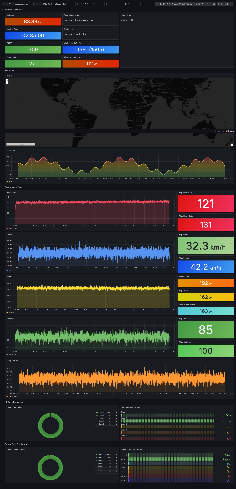
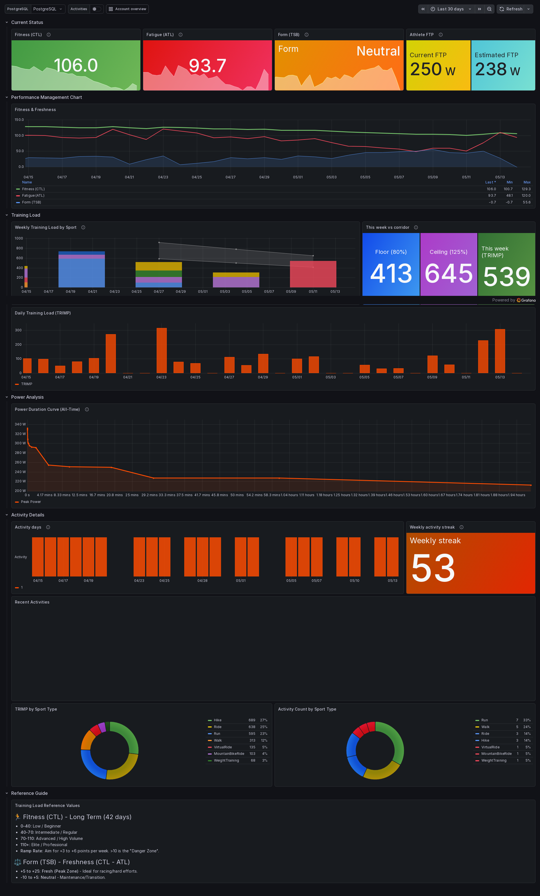
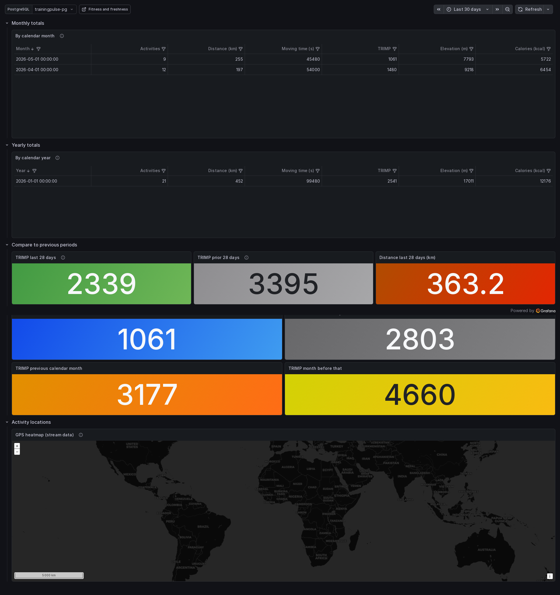
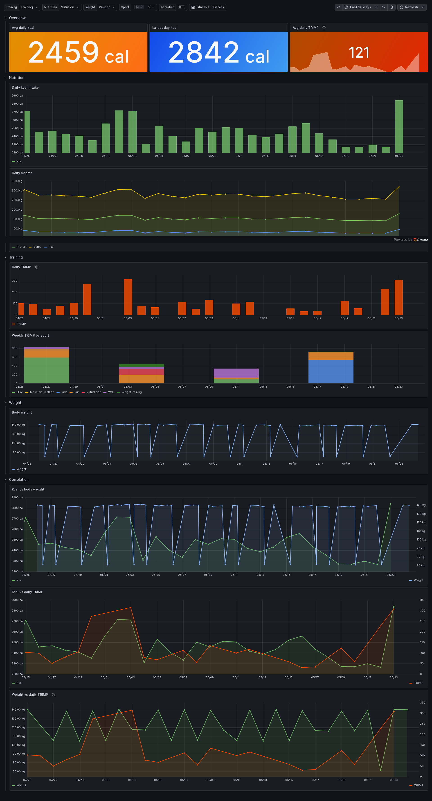

<p align="center">
  
</p>

# TrainingPulse

Self-hosted sync and dashboards for your training: activities from **intervals.icu**, **Strava**, **Google Health**, and **Hammerhead** (Karoo bike computers), body weight from **Withings**, and nutrition from **FDDB**. PostgreSQL storage, training-load metrics (**TRIMP**, CTL, ATL, TSB, FTP estimates), and Grafana visualization.

## Trademarks and API use

**TrainingPulse is not affiliated with, endorsed by, or sponsored by intervals.icu, Strava, Google, Hammerhead/SRAM, Withings, or FDDB.** Each person who runs this stack must use their own API credentials and comply with the respective terms of service. Activity data shown from Strava is **Powered by Strava**.

## Disclaimer

This project is largely AI-generated. The numbers it computes — including training load, fitness, fatigue, form, and FTP estimates — are informational only and **are not medical advice**. Verify anything you plan to act on, and consult a qualified professional for health or training decisions.

## Grafana dashboards

Example views from the bundled dashboards.

<table>
<tr>
<td align="center" valign="top" width="25%">
<a href="screenshots/activity_detail.png"></a><br />
<sub>Activity detail</sub>
</td>
<td align="center" valign="top" width="25%">
<a href="screenshots/fitness.png"></a><br />
<sub>Fitness &amp; Freshness</sub>
</td>
<td align="center" valign="top" width="25%">
<a href="screenshots/account_overview.png"></a><br />
<sub>Account overview</sub>
</td>
<td align="center" valign="top" width="25%">
<a href="screenshots/nutrition_training_weight.png"></a><br />
<sub>Nutrition &amp; weight</sub>
</td>
</tr>
</table>

## What you need

- Docker and Docker Compose
- Your max HR, resting HR, and FTP — these are **required** and are the only source of zone data (see [Athlete settings](#athlete-settings))
- An account with at least one provider. Each one supplies one or more data kinds:

  | Provider | Supplies | What you need |
  |---|---|---|
  | intervals.icu | activities | API key (Settings → Developer Settings) |
  | Strava | activities | API application (<https://www.strava.com/settings/api>), callback domain set to your app host |
  | Google Health | activities | Google Cloud OAuth client with the Google Health API enabled, redirect URI `{app.base_url}/auth/google/callback` |
  | Hammerhead | activities | API client (<https://support.hammerhead.io/hc/en-us/sections/42738685226523-Public-API>), redirect URI exactly `{app.base_url}/auth/hammerhead/callback` |
  | Withings | body (weight, fat %, muscle mass) | Partner Hub app, callback URL `{app.base_url}/plugins/withings/get_token` |
  | FDDB | nutrition (kcal, macros) | Username, password, and the `fddb` session cookie from your browser |

## Setup

1. **Write your configuration.** All application settings live in a single `config.yaml`:

   ```bash
   cp config.example.yaml config.yaml
   cp .env.example .env
   ```

   Edit `config.yaml`: set the required `athlete` values, then enable the providers you use under `providers`. `.env` only carries Compose-level variables (the Postgres credentials and the published MCP port).

   `config.yaml` is gitignored. You can put credentials in it directly, or keep them in the environment and reference them as `${VAR}` — the example file shows both. Every key also has a `TP_SECTION__KEY` environment override, e.g. `TP_DATA__ACTIVITIES__REFRESH_DAYS=7`.

   Startup fails with every problem listed at once if the file has an unknown key, a wrong type, a missing required value, or a provider that is enabled without credentials.

2. **Start the stack.** From the repo root:

   ```bash
   docker compose up -d
   ```

   This brings up four containers: the FastAPI app on port `8000`, Grafana on port `3000`, the MCP service on port `8001`, and PostgreSQL (internal only).

3. **Connect providers.** Open the app at `http://your-host:8000/`. intervals.icu and FDDB sync automatically once their credentials are set. Strava, Google Health, Hammerhead, and Withings use OAuth — click **Connect** next to each. One sync runs every provider every 15 minutes.

   **Google OAuth tip:** set the consent screen publishing status to **In production** (you can leave the app unverified for personal use) so refresh tokens are not limited to 7 days. Testing mode requires reconnecting about weekly.

   **Strava rate limits:** Strava's default read budget is 100 requests per 15 minutes and 1000 per day — roughly twenty times tighter than intervals.icu. A full multi-year backfill including streams can take several days. It pauses and resumes automatically, and Strava's card on the status page shows the remaining daily budget.

   **Hammerhead:** every activity's `.fit` file is downloaded once and permanently stored — it is the only source of heart rate, power, cadence, and elevation data for Hammerhead-sourced activities, since the API's own JSON payload doesn't carry any of that.

4. **Open Grafana.** Browse to `http://your-host:3000/`, or use **Open dashboards** on the status page. If Grafana is not on port 3000 of the app's host, set `app.grafana_url` so the link points to it. The Postgres datasource **`trainingpulse`** and the bundled dashboards are provisioned automatically.

5. **Optional: connect an MCP client.** The read-only MCP service is available at `http://your-host:8001/mcp`.

## Athlete settings

`athlete.max_hr`, `athlete.rest_hr`, and `athlete.ftp` are **required** and have no defaults. No provider is asked for a profile, so these values alone determine your heart-rate zones and power zones, and therefore TRIMP and all of CTL / ATL / TSB. Getting them wrong produces plausible-looking but incorrect numbers, which is why startup refuses to guess.

Heart-rate zones are computed from `max_hr` and `rest_hr` using the standard five-zone percentage model. A changed value applies to activities synced from then on. If a value was wrong from the start, open **Full resync** under the athlete settings on the status page to recalculate your whole history with the corrected value.

### Calories

TrainingPulse computes calories itself instead of trusting the device: at the same heart rate, a Fitbit reported about 1.9× what a Galaxy Watch did, and Strava's heart-rate formula about 1.7× what measured power implies. The first rule that applies wins:

1. **Measured power:** kcal = work (kJ) / (4.184 × 0.22), intervals.icu's rule at 22% gross efficiency. Work is the sum of the power stream (else average watts × moving time). Strava's factor (× 1.115) comes out 2.6% higher.
2. **Walk, hike, run with a distance:** the ACSM metabolic equations from distance, elevation gain, moving time and body weight.
3. **Heart rate, any other sport:** heart rate is turned into power via `ftp` (power ≈ `ftp` × heart-rate reserve / 0.88), then rule 1 applies. A wrong `ftp` shows up here directly.
4. **Otherwise the imported value**, if the source has one.
5. **Last resort:** a MET value from the Compendium of Physical Activities × body weight × time.

On the activity page a `~` marks values not derived from measured power, and a differing imported value is shown next to it. Body weight comes from the weigh-in closest to the activity date; set the optional `athlete.weight_kg` to cover activities when no body data is imported.

Calories are computed once, when an activity is processed, with the athlete values configured at that time, like TRIMP. Changing `ftp` or `weight_kg` does not rewrite older activities, and activities processed before this feature keep their imported values. A **Full resync** recomputes all history with the current values.

## Providers and data kinds

Your data may be spread over services differently from anyone else's, so TrainingPulse treats every service the same way: a **provider** is an account you connect, and it supplies one or more **data kinds** (`activities`, `body`, `nutrition`). Each provider block in `config.yaml` takes an optional `imports` list to choose which kinds to take from it; leave it out to take everything the provider supports.

Every kind has one table, one set of dashboards, and one set of MCP tools, whichever provider filled it. Body weight and nutrition appear in the Grafana dashboard under the **Addons** folder.

## Multiple providers and duplicates

The same workout, weigh-in, or diary day often lands in more than one service. `data.<kind>.precedence` lists providers highest-priority first for each kind. Every provider's rows are stored; precedence only decides which are visible:

- **Activities** compete when they start within 15 minutes of each other *and* their time ranges overlap.
- **Body measurements and nutrition** compete per calendar day in `athlete.timezone`: the highest-ranked provider with any data that day wins the whole day.

Hidden rows keep `superseded_by` pointing at the winner. The `active_activities`, `active_body_measurements`, and `active_daily_nutrition` views and every Grafana dashboard and MCP tool read only the visible rows, so nothing is double-counted.

An activity that a provider stops serving (deleted there, or past a retention limit) is hidden too, but never deleted: its row, streams, and FIT file stay in the database with `deleted_upstream_at` set, it no longer hides other providers' copies of the same workout, and it reappears if the provider lists it again.

Hidden activities do not spend API calls on detail or stream fetches. That is what keeps a tight-budget provider like Strava from burning its quota on workouts you will never see.

Precedence is reversible: reorder a kind's `precedence`, restart, and the next sync recomputes which rows are visible and fetches whatever the new winners are missing. No re-backfill is needed. Precedence is positional and independent of the `enabled` flag, so disabling a provider does not silently promote another provider's rows over its history.

## What is stored

**From your providers, stored locally:**

- Activity summaries (sport, time, distance, HR, power when available) with a `source` of `icu`, `strava`, `google_health`, or `hammerhead`
- Activity streams (HR, power, GPS when available) for maps and zone/TRIMP calculations
- Strava's "relative effort" as `suffer_score` (Strava only; NULL elsewhere)
- For Hammerhead: the raw `.fit` file itself, downloaded once per activity and permanently stored — it backs both the activity summary and its streams, since Hammerhead's API returns no HR/power/elevation data on its own
- Activities that have since disappeared upstream, hidden but kept (see [Multiple providers and duplicates](#multiple-providers-and-duplicates))
- Body measurements (weight, fat %, muscle mass) and daily nutrition totals, tagged with the provider they came from
- OAuth tokens for Strava, Google Health, Hammerhead, and Withings (auto-refreshed); intervals.icu and FDDB use their configured credentials
- Athlete settings, projected from `config.yaml` — **no provider profile, zone, or FTP data is ever requested**

**Computed locally:**

- TRIMP, HR/power zone time, estimated FTP, daily CTL / ATL / TSB

## Upgrading

Upgrading **preserves your activity history**. The schema is migrated in place: Strava-era numeric ids become `strava_<id>`, and a Strava-era `activity_streams` table is re-prefixed rather than dropped.

If you are coming from a release where Strava had been removed:

- The `suffer_score` column is re-added, and preserved `strava_<id>` rows are re-queued for a detail fetch to recover it. Their streams are left alone because the earlier migration kept them. Only rows that win on precedence are actually fetched.
- Strava OAuth now lives in the shared `oauth_tokens` table, so you need to reconnect Strava once.
- **Configuration is a breaking change.** All environment variables have been replaced by `config.yaml` plus the `TP_SECTION__KEY` override scheme. Copy `config.example.yaml` and migrate your `.env` values across; the old flat names (`INTERVALS_ICU_API_KEY`, `SYNC_RECONCILE_DAYS`, `ENABLED_PLUGINS`, …) are no longer read.

If you used the Withings or FDDB plugins:

- Their data moves out of the `withings` and `fddb` schemas into the core `body_measurements` and `daily_nutrition` tables on first start, in the same transaction as the rest of the migration. The old schemas are dropped once empty.
- The Withings token moves into `oauth_tokens`, so you do **not** need to reconnect Withings, and its Partner Hub callback URL stays `{app.base_url}/plugins/withings/get_token`.
- Move `plugins.withings` and `plugins.fddb` to `providers.withings` and `providers.fddb`. Their `sync_interval_minutes` and `sync_lookback_days` are gone: one sync covers every provider, and history lengths are `data.body.history_days` and `data.nutrition.history_days`. Startup names any old key and where it went.
- Set `athlete.timezone` (default `UTC`) so weigh-ins are assigned to the right day.
- The `/plugins/withings/` and `/plugins/fddb/` pages are gone; both providers appear on the status page.
- **Heart-rate zones now come only from configuration.** If you previously relied on custom zones from intervals.icu, zones are now computed from `athlete.max_hr` and `athlete.rest_hr`. This changes TRIMP and therefore all historical CTL / ATL / TSB. Run **Full resync** after checking your values.

For architecture, the HTTP API, the configuration schema, and metric formulas, see [`DEVELOPERS.md`](DEVELOPERS.md).
