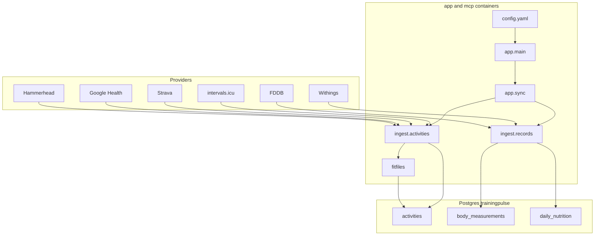

# Developer notes

Technical reference for **TrainingPulse**. Day-to-day setup lives in the [user documentation](README.md); this file covers architecture, provider APIs, the HTTP API, the configuration schema, and how training metrics are calculated.

## Architecture

```
intervals.icu  ─┐
Strava         ─┤ activities
Google Health  ─┤
Hammerhead     ─┤                 ┌→ PostgreSQL (trainingpulse)
Withings       ─┤ body            │    activities, body_measurements,
FDDB           ─┘ nutrition       │    daily_nutrition + active_* views
                  → [app/ FastAPI core] ┘
Grafana → provisioned Postgres datasource
MCP → same database as core
```

The core service in [`app/`](../app/) handles provider authentication, APScheduler, TRIMP/CTL/ATL/TSB, and the status UI. The MCP server runs from the same code in its own container.



## Providers and data kinds

Two independent axes, both declared in [`catalog.py`](../app/catalog.py):

- A **data kind** (`activities`, `body`, `nutrition`, `sleep`, `wellness`, `intraday`) is something TrainingPulse stores and shows. The core owns its table, its duplicate rule, its dashboards, and its MCP tools.
- A **provider** is an account the user connects. It authenticates once, owns one rate budget, and offers a **feed** per kind it can supply. `ProviderSpec.kinds` lists the kinds that have a working feed; config validation rejects importing anything else.

| Kind | Table | Duplicate rule |
|------|-------|----------------|
| activities | `activities` | `OVERLAP`: starts within 15 min and time ranges overlap |
| body | `body_measurements` | `PER_DAY`: one provider wins each local day |
| nutrition | `daily_nutrition` | `PER_DAY` |
| sleep | `sleep_sessions` | `PER_DAY`, keyed by the day the night ends |
| wellness | `daily_wellness` | `PER_DAY` |
| intraday | `wellness_samples` | `PER_DAY`, keyed by the local day of each sample |

The `Provider` contract is in [`app/providers/base.py`](../app/providers/base.py) and the feed contracts in [`app/providers/feeds.py`](../app/providers/feeds.py). All seven providers live in [`app/providers/`](../app/providers/). The five activity providers are each their own `ActivityFeed`; Withings and FDDB return separate `BodyFeed` / `NutritionFeed` objects, Garmin also returns body, sleep, wellness, and intraday feeds ([`garmin_wellness.py`](../app/providers/garmin_wellness.py)), and Google Health sleep, wellness, and intraday feeds ([`google_wellness.py`](../app/providers/google_wellness.py)). A provider that gains a second kind returns one more feed from `feeds()`.

### Non-activity kinds

A `RecordFeed` only lists a window (`list_records(start, end)`) and maps each payload to a canonical record (`map_record`, pure). [`app/ingest/records.py`](../app/ingest/records.py) does the rest identically for every provider:

- **Window.** The first sync walks `data.<kind>.history_days`. Later syncs re-list from `min(caught-up day, today − refresh_days)`, so a provider that was unreachable catches up instead of leaving a gap. The caught-up day is the later of the newest stored day and `record_sync_cursors.synced_through`, which is written only after every window listed successfully, so days that simply had no data are not re-listed on every run. Windows are whole local days in `athlete.timezone`, chunked by `sync.window_days`.
- **Upsert** on `(provider, external_id)` for body and `(provider, day)` for nutrition, deduplicating within a batch.
- **Dedup.** `choose_daily_winners` is a pure function over `(day, provider)` pairs. `recompute_daily_supersessions` writes only the changes, grouped by target, and sets `superseded_by` to the winning *provider name*.

### Adding a provider

1. Write the provider class (in `app/providers/<name>.py`) implementing `Provider`. Give it a pure, module-level mapper for each feed so it can be tested against recorded payloads.
2. Keep anything async out of mappers. If a row needs a second call (Strava resolves gear names this way), make it in `fetch_detail` and return an augmented payload.
3. Add a `ProviderSpec` to `PROVIDERS` in the catalog, and the kind's ranking to `DEFAULT_PRECEDENCE`.
4. Add a config section in `app/config_loader.py`: a `_ProviderSection` (or `_OAuthProviderSection`) subclass with credentials marked `secret()` and `missing_credentials()`, plus a field on `ProvidersSection`.
5. Register a builder in [`app/providers/registry.py`](../app/providers/registry.py).
6. Add fixtures and mapper tests. `test_feeds_match_the_catalog_and_their_contracts` fails until the provider's feeds match its `ProviderSpec`. For an activity provider, `test_mappers_agree_on_the_column_set` fails until the mapper emits exactly the same columns as the others.

### The wellness baseline and derived scores

Sleep, wellness, and intraday records carry only fields most wearables report (see the record dataclasses in `providers/feeds.py`). Provider-specific scores (Garmin's sleep score, stress, Body Battery, HRV status) are deliberately not mapped: they are not comparable across providers and most APIs do not expose them. A new provider maps onto the baseline and leaves unknown fields `None`.

Everything comparable that can be derived is derived in the core, from visible rows only: [`app/wellness_scores.py`](../app/wellness_scores.py) recomputes `daily_scores` (sleeping heart rate, sleep score, recovery score, each with its parts as JSON) after every sync, and [`app/resting_hr.py`](../app/resting_hr.py) supplies the 7-day median resting heart rate that replaces `athlete.rest_hr` for calories. The formulas are documented in [Sleep and recovery scores](sleep-and-recovery.md).

OAuth providers whose kinds need different scopes (Google Health) report the readable kinds from `granted_kinds()`, based on the scopes stored in `oauth_tokens.scopes`. The sync skips a kind the token cannot read, and the status page asks for a reconnect.

### Adding a data kind

Add it to `DataKind` and `KINDS`, add a record dataclass and feed protocol in `providers/feeds.py`, a model and a `RecordStore` in `ingest/records.py` (for a per-day kind), a field on `DataSection`, its `active_*` view in `schema_migrate._ACTIVE_VIEWS`, and MCP tools. Every record kind so far is per-day: sleep is keyed by the day the night ends, intraday samples by the local day of their timestamp. A kind with several sessions per day would need the overlap rule from `ingest.activities.choose_winners` instead of `choose_daily_winners`.

## Activity providers

Activity primary keys are **strings** with a source prefix:

- `icu_<intervalsId>` — e.g. `icu_i55610271`
- `strava_<stravaId>` — e.g. `strava_1122334455`
- `ghealth_<dataPointId>` — Google Health exercise resource id
- `hammerhead_<activityId>` — e.g. `hammerhead_1000.activity.abcd`

Column `activities.source` is `icu`, `strava`, `google_health`, or `hammerhead`. Prefixing is idempotent, so ids preserved across earlier migrations map back onto themselves.

### The activity contract

Each activity provider implements `ActivitySource` in [`app/providers/base.py`](../app/providers/base.py), which is `Provider` and `ActivityFeed` combined. It knows only how to authenticate, list a date window, fetch one activity's detail and streams, and map a provider payload onto `activities` columns. Backfill, incremental sync, reconciliation, queue draining, concurrency, rate-limit pausing, and supersession all live once in [`app/ingest/activities.py`](../app/ingest/activities.py).

| Member | Purpose |
|--------|---------|
| `name`, `id_prefix` | Value stored in `activities.source` and the id prefix |
| `supports_detail` | False when the list payload is already complete (Google Health) |
| `supports_streams` | False when the provider has no time series |
| `supports_reconcile` | False when re-listing a recent window is too expensive |
| `auth`, `kind` | `AuthMethod` (OAuth drives the status-page Connect button); always `DataKind.ACTIVITIES` |
| `connect_path` / `disconnect_path` | Routes mounted by `register_auth_routes` |
| `is_configured()` / `is_connected()` | Credentials present / usable right now |
| `verify_credentials()` | Fail-fast auth check; returns a provider athlete id. **Never** used for zones or FTP |
| `list_activities(start, end)` | Provider payloads for a half-open window; the source owns its own pagination |
| `fetch_detail(external_id)` | One activity's detail; `None` means gone upstream (the row is hidden via `deleted_upstream_at`, never deleted, and restored if listed again) |
| `fetch_streams(activity)` | Canonical `{stream: [samples]}` |
| `map_row(payload, athlete_id)` | **Pure and synchronous** — provider payload to column dict. For a source with detail, a re-listed row whose detail is already merged is not overwritten, so the list mapping may omit detail-only columns |
| `rate_limits()` | Quota snapshot for the status page |
| `feeds()`, `granted_kinds()` | `{ACTIVITIES: self}`; the provider-level view |

### intervals.icu

| Method | Endpoint | Role |
|--------|----------|------|
| List | `GET /api/v1/athlete/0/activities?oldest=&newest=` | Date-window list / backfill |
| Detail | `GET /api/v1/activity/{id}` | Merge notes, calories, gear |
| Streams | `GET /api/v1/activity/{id}/streams.json` | HR / power / GPS |
| Athlete | `GET /api/v1/athlete/0` | Credential check and athlete id only |

Auth: Basic, username `API_KEY`, password = personal API key. Rate limits ~2500 / 15 min and 5000 / day. A browser-like `User-Agent` is **required** (Cloudflare).

Sport-settings are deliberately not requested; see [HR and FTP](#hr-and-ftp).

### Strava

| Method | Endpoint | Role |
|--------|----------|------|
| List | `GET /athlete/activities?after=&before=&per_page=200` | Paged window list |
| Detail | `GET /activities/{id}` | Description, calories, device, suffer score |
| Gear | `GET /gear/{id}` | Display name; cached per client |
| Streams | `GET /activities/{id}/streams?key_by_type=true` | HR / power / GPS |
| Athlete | `GET /athlete` | Credential check and athlete id only |

Auth: OAuth, scopes `activity:read_all,profile:read_all`. Tokens live in `oauth_tokens` (`provider=strava`), refreshed automatically. Callback is `{app.base_url}/auth/strava/callback`.

Strava publishes **two** budgets per response: `X-RateLimit-*` (overall) and `X-ReadRateLimit-*` (reads only), defaulting to 200/2000 and 100/1000. Almost every call here is a read, so the client gates on whichever budget is closer to its limit. The 15-minute window resets on the quarter hour; the client sleeps until then, and a daily exhaustion raises `SourceRateLimitExceeded` so the phase resumes next sync.

`suffer_score` is Strava's relative effort and is NULL for every other source.

### Google Health

| Data | Endpoint | Role |
|------|----------|------|
| Exercises | `GET .../dataTypes/exercise/dataPoints` | Sessions, complete in the list payload |
| Heart rate | `GET .../dataTypes/heart-rate/dataPoints` | Streams for TRIMP |
| Route | `GET .../dataTypes/exercise/dataPoints/{id}:exportExerciseTcx?alt=media` | GPS, altitude, distance and HR streams (needs `googlehealth.location.readonly`) |

Auth: Google OAuth (`access_type=offline`). Tokens in `oauth_tokens` (`provider=google_health`). The Google Health scopes are sensitive, so publishing the consent screen **In production** requires Google verification. Personal deployments stay in **Testing** with the user added as a test user, which means Google expires the refresh token after 7 days and the user must reconnect weekly. Workspace accounts can use the **Internal** user type instead, which has no such limit.

Exercises only filter on `exercise.interval.civil_start_time` (local time), so the client widens each window by a day and trims on the physical start. `MetricsSummary` has no max heart rate, and Strava sessions synced through Health Connect have an empty one; the stream phase derives missing average/max heart rate, distance and average speed from the streams, and re-listing keeps those values.

`supports_detail` is False (the list payload is complete) and `supports_reconcile` is False, because Google Health publishes no per-activity update marker worth re-listing for. Google publishes no usable quota headers, so `rate_limits()` reports `known: false` rather than a misleading 0/0.

### Hammerhead

| Method | Endpoint | Role |
|--------|----------|------|
| List | `GET /activities?startDate=&page=&perPage=` | Date-window list; no upper bound |
| Detail | `GET /activities/{id}` | `activityType`, `description`, `updatedAt` only |
| FIT file | `GET /activities/{id}/file` | Raw `.fit` bytes — see [FIT file analysis](#fit-file-analysis) |

Auth: OAuth, scope `activity:read`. Tokens live in `oauth_tokens` (`provider=hammerhead`), refreshed automatically. Callback is `{app.base_url}/auth/hammerhead/callback`. Unlike Strava, the token response has no `expires_at` (only `expires_in`), and the authorization-code exchange requires `redirect_uri` in the request body. `disconnect()` best-effort calls `POST /oauth/deauthorize` before removing the local token.

**Its list/detail JSON carries no heart rate, power, cadence, or elevation data at all** — `ActivitySummary` is just `{id, name, createdAt, duration, distance}`, and the detail response only adds `activityType`/`description`/`updatedAt`. Every aggregate column (HR, power, moving/elapsed split, elevation gain, calories, device) and every stream comes from analyzing the `.fit` file, downloaded once per activity via `fetch_detail`/`fetch_streams` and permanently stored (see below). `map_row` reads these from a private `_fit_summary` key that `fetch_detail` attaches to the payload before mapping, keeping `map_row` itself pure. In the summary, `duration` is the moving time in **milliseconds** and `createdAt` is when the ride was saved, i.e. its **end**; the list phase derives the provisional start as `createdAt - duration`. These provisional values must stand on their own: a row superseded by another source never gets a detail merge.

`supports_reconcile` is False: because the list summary is missing everything a reconcile diff would need to detect an edit, re-listing would look like every activity changed on every pass and force a wasted FIT re-download for the whole window. `list_activities` also pads its `start` by `_LIST_SAFETY_MARGIN_DAYS` (14 days) before querying `startDate`, since a Karoo device can sync a ride to the cloud well after it was recorded. Hammerhead publishes no rate-limit headers, so `rate_limits()` reports `known: false`.

### Withings

| Method | Endpoint | Role |
|--------|----------|------|
| List | `POST /measure?action=getmeas&meastypes=1,6,76&category=1` | Weight, fat ratio, muscle mass; pages via `more`/`offset` |

Auth: OAuth, scopes `user.metrics,user.info`. Tokens live in `oauth_tokens` (`provider=withings`, Withings `userid` in `external_user_id`). Withings rotates refresh tokens, so every refresh response is stored. Its errors arrive as HTTP 200 with a non-zero `status`: 401 triggers one forced refresh and retry, and 601 raises `SourceRateLimitExceeded`. `category=1` excludes the user's goal weights.

The callback stays `{app.base_url}/plugins/withings/get_token`, with `/plugins/withings/auth/callback` as a legacy alias, because Partner Hub apps registered it when Withings was a plugin. It answers `HEAD` with 200, which Partner Hub uses to validate the URL.

### FDDB

A scraper with no API: one `GET /db/i18n/myday20/?p=&q=` per diary day, authenticated with Basic auth plus the `fddb` session cookie. Days come from FDDB's own diary, so `NutritionRecord.day` is FDDB's date, not derived from a timestamp. `request_delay_ms` spaces the requests. A login page raises `FddbAuthenticationError`, which stops that provider's sync with a clear error.

### FIT file analysis

[`app/fitfiles/`](../app/fitfiles/) is a small, source-agnostic package for turning raw `.fit` bytes into a `FitSummary` (aggregate metrics) and canonical streams (`fitfiles.analyzer.analyze_fit_file`, built on `fitdecode`), plus a permanent store (`fitfiles.store`) keyed by the local activity id in the `activity_fit_files` table (one row per activity, `BYTEA`). Any current or future source that can hand it raw FIT bytes gets the same analysis — it has no knowledge of Hammerhead or any other provider.

Hammerhead's source adapter downloads a FIT file at most once: `fetch_detail` downloads-and-stores it if missing, and `fetch_streams` reuses whatever is already stored (falling back to a download only if it runs before detail has, e.g. after a rate-limit pause). A missing or unreadable FIT file degrades gracefully — detail still merges `name`/`description`/`activityType`, just without HR/power/etc., and streams return `{}` (the engine's existing no-HR TRIMP estimate then applies).

## Activity precedence and supersession

The activity part of a run is two-pass, and the ordering is load-bearing:

1. **List** — each enabled source, in precedence order, lists its window and upserts summary rows.
2. **Supersede** — `recompute_supersessions` recomputes `superseded_by` across *every* stored row.
3. **Enrich** — each source drains its detail queue, fetching each activity's streams right after its detail (while anything derived for both, such as Hammerhead's parsed FIT file, is still at hand), then drains the remaining stream queue. Both are limited to visible activities, and each activity is attempted at most once per sync, so one that keeps failing costs one request per run.
4. **Supersede again** — detail can change `elapsed_time`, which can change what overlaps. Idempotent.
5. **Derive** — estimated FTP, power curves, daily CTL/ATL/TSB.

Two activities compete when their starts are within `START_TOLERANCE_SECONDS` (900) **and** their time ranges genuinely overlap. The winner is decided by `(precedence index, longer duration, earlier start, id)`. Comparison is pairwise rather than transitive, so a chain of near-misses cannot collapse two activities that do not actually overlap; winner chains are then resolved to their root so `superseded_by` always points at a visible row.

`choose_winners` in [`app/ingest/activities.py`](../app/ingest/activities.py) is a pure function over `(id, source, start, elapsed)` tuples and is tested directly.

Two properties worth preserving:

- **Precedence is positional and ignores `enabled`.** Preserved `strava` rows must keep outranking Google Health after Strava is disabled, or reordering the list silently rewrites history. A startup warning fires, per kind, when an inactive provider outranks an active one.
- **Losers are stored, not dropped.** That is what makes reordering `data.<kind>.precedence` reversible without a re-backfill. Hidden rows never spend detail or stream calls.

### Activities gone upstream

When `fetch_detail` returns `None` (the provider answered 404/410), the row is soft-deleted: `deleted_upstream_at` is set and the row, its streams, and its FIT file are kept. "Gone" can also mean a retention limit or a lost scope, and stored streams and FIT files cannot be fetched again. A gone activity takes no part in supersession, so it neither stays hidden behind another copy nor keeps suppressing the copies other sources hold. If a later listing includes it again, `upsert_rows` clears the mark and re-queues its detail.

`ACTIVITY_VISIBLE` in [`app/models.py`](../app/models.py) (`superseded_by IS NULL AND deleted_upstream_at IS NULL`) is the one condition every query, metric, and queue uses for "shown".

After activities, each record kind is synced provider by provider in its precedence order, each isolated so one failure does not stop the others, and then deduplicated per day.

The `active_activities` (`ACTIVITY_VISIBLE`), `active_body_measurements`, and `active_daily_nutrition` (`superseded_by IS NULL`) views are what Grafana reads. They are dropped and recreated on migration rather than replaced, because `CREATE OR REPLACE VIEW` can only append columns to a `SELECT *` view.

## HTTP API

| Method | Endpoint | Description |
|--------|----------|-------------|
| `GET`  | `/` | Status page: accounts, sync progress, where each data kind comes from |
| `GET`  | `/partials/live` | The status page's auto-refreshing region, as HTML |
| `GET`  | `/auth/strava` | Start Strava OAuth |
| `GET`  | `/auth/strava/callback` | OAuth redirect; stores tokens |
| `POST` | `/auth/strava/disconnect` | Remove Strava tokens |
| `GET`  | `/auth/google` | Start Google Health OAuth |
| `GET`  | `/auth/google/callback` | OAuth redirect; stores tokens |
| `POST` | `/auth/google/disconnect` | Remove Google Health tokens |
| `GET`  | `/auth/hammerhead` | Start Hammerhead OAuth |
| `GET`  | `/auth/hammerhead/callback` | OAuth redirect; stores tokens |
| `POST` | `/auth/hammerhead/disconnect` | Remove Hammerhead tokens |
| `GET`  | `/auth/withings` | Start Withings OAuth |
| `GET`/`HEAD` | `/plugins/withings/get_token` | OAuth redirect; stores tokens (path kept for Partner Hub) |
| `POST` | `/auth/withings/disconnect` | Remove Withings tokens |
| `GET`  | `/sync/status` | JSON sync status, including per-provider quota |
| `POST` | `/sync/trigger` | Incremental sync |
| `POST` | `/sync/full` | Full historical resync |

OAuth routes are mounted by the providers themselves via `register_auth_routes`, not hardcoded in `app/main.py`. The Google and Withings callback paths are fixed strings because they are already registered in users' OAuth clients.

## Configuration

All application settings come from a single YAML file. The schema, loader, and validation live in [`app/config_loader.py`](../app/config_loader.py); [`app/config.py`](../app/config.py) loads it once at import and exits non-zero with a readable message if anything is wrong.

`config.example.yaml` is the reference. Sections: `app`, `database`, `athlete`, `providers`, `data`, `sync`, `mcp`.

- `providers.<name>`: `enabled`, credentials, and `imports` (the kinds to take; omitted means all the provider supports).
- `data.<kind>`: `precedence`, `history_days`, `refresh_days`. Omitted values come from the catalog, and supporting providers left out of `precedence` are appended.

Keys from the earlier `sources:` / `plugins:` shape (`sources`, `plugins`, `sync.backfill_years`, `sync.reconcile_days`) fail with a message naming where each one moved.

### Where the file comes from

`$TP_CONFIG_FILE` → `/config/config.yaml` → `./config.yaml`. A missing file is a hard error; `athlete.*` is required, so there is no useful zero-config boot.

### Two environment mechanisms

These are independent and easy to confuse:

1. **Structural overrides** — `TP_<SECTION>__<KEY>`, double underscore for nesting, applied to the parsed document before validation. Lists accept a comma-separated string (`TP_DATA__ACTIVITIES__PRECEDENCE=icu,strava`); booleans accept `1/true/yes/on` and their negatives. An unknown `TP_*` name is an error naming the variable, not a silent no-op.
2. **Value interpolation** — `${VAR}` or `${VAR:-default}` *inside* a YAML string value, expanded textually before validation. These names are user-chosen and carry no `TP_` prefix. An unset `${VAR}` with no default becomes an empty string and logs a warning; the enabled-without-credentials check then reports it properly.

Precedence is **env override > YAML value > built-in default**.

### Validation

Models use `extra="forbid"`, so a typo is a hard error rather than a silently ignored key. Every problem — unknown keys, wrong types, missing required values, unknown or unsuitable providers in a `precedence` or `imports` list, a provider enabled with blank credentials — is collected and reported in one message, then the process exits non-zero.

On startup the effective configuration is logged at INFO with every field marked `secret()` masked. `test_every_sensitive_looking_field_is_marked_secret` fails if a new credential field is added without that marker.

### Compose-level variables

`POSTGRES_USER` / `POSTGRES_PASSWORD` / `POSTGRES_DB` stay in `.env`: the `db` container and Grafana's `datasource.yml` need them as environment variables. Compose composes `TP_DATABASE__URL` from them so the connection string is not duplicated in `config.yaml`. `MCP_PORT` in `.env` is only the published host port; the container always listens on `mcp.port`.

## HR and FTP

`athlete.max_hr`, `athlete.rest_hr`, and `athlete.ftp` are **required** and have no defaults. No provider profile, sport-settings, or zone endpoint is ever called, so `athlete_settings.hr_zones` stays NULL and `get_hr_zone_boundaries` always computes percentage-based zones from `max_hr` and `rest_hr`.

`athlete_settings.estimated_ftp` is still derived locally as 95% of the best 20-minute power across visible activities; it is a computed value, not configuration.

Changing an athlete value only affects activities processed afterwards. A full resync re-downloads everything and recalculates all history with the current values, which is only right when the old value was wrong rather than outdated.

### Computed calories and kilojoules

`calories.compute_energy` fills `activities.computed_calories`, `computed_kilojoules` (measured power only) and `computed_calories_method` (`power`, `acsm`, `hr_power`, `met`). `_apply_streams` calls it once per activity on every exit (no HR/power, normal, and the error fallback), with inputs captured before any rollback, the stream work sum for power, and the nearest visible weigh-in (else `athlete.weight_kg`). Nothing recomputes it later: like TRIMP it reflects the config at processing time, and a full refresh or resync recomputes it. Imported `calories`/`kilojoules` are never overwritten; readers use `COALESCE(computed_calories, calories)` and `COALESCE(computed_kilojoules, kilojoules)`.

Computed values win over imported ones because devices disagree at the same effort (Fitbit ~1.9× a Galaxy Watch for identical heart rates; Karoo 2 ~1.3× and Strava's HR formula ~1.7× what measured power implies). The power rule is intervals.icu's (kcal = kJ / (4.184 × 0.22)), checked against its reported calories to within 0.5 kcal on every ride; the stream work sum matches `icu_joules`. intervals.icu's work comes from `icu_joules` (joules, mapped to `kilojoules`), never from `calories`.

`hr_power` (heart rate → watts via FTP, then the power rule) replaces weight-based formulas for every heart-rate sport except walk/hike/run with a distance: it matched measured power to 0.91–0.98 and a Galaxy Watch's strength sessions to 0.97–0.98, while Keytel, %HRR × VO2max and MET × weight overshoot heavier athletes by 1.8–2.7×. MET only applies when there is no power, distance, heart rate or imported value.

**Upgrading from the old `.env`-only setup:** earlier releases fell back to generic HR/FTP defaults (190/60/200) when `MAX_HR`/`REST_HR`/`FTP` were unset. That fallback is gone — the process now exits non-zero if `athlete.*` is missing. Add `athlete.max_hr`/`rest_hr`/`ftp` to `config.yaml`, or set `TP_ATHLETE__MAX_HR` / `TP_ATHLETE__REST_HR` / `TP_ATHLETE__FTP` as environment variables (the structural-override mechanism creates the section even if `config.yaml` omits it entirely) before restarting.

## Schema upgrades

On startup [`app/schema_migrate.py`](../app/schema_migrate.py) migrates **in place and preserves all activity history**:

- Strava-era bigint `activities.id` becomes `VARCHAR(128)` and is prefixed `strava_`; `activity_streams.activity_id` is migrated and re-prefixed to match, not dropped.
- `strava_detail_synced` → `detail_synced`, `strava_updated_at` → `provider_updated_at`; `source` and `superseded_by` are added.
- `suffer_score` is re-added if missing, and in the same guarded branch preserved `strava` rows are re-queued for a detail fetch. Streams are deliberately left alone because the earlier migration kept them, and refetching them would waste Strava's read budget. The guard is the column's absence, so this runs exactly once per database.
- `strava_tokens` is dropped; Strava OAuth lives in `oauth_tokens` now, so Strava must be reconnected once.
- `activities.deleted_upstream_at` is added if missing (`create_all` never adds columns to existing tables). New tables such as `record_sync_cursors` are created by `create_all`.
- Short-lived `fitbit` labels are renamed to `google_health`, including the `fitbit_` id prefix.
- Withings plugin data in `withings.weight_measurements` is copied into `body_measurements` (`provider=withings`, `external_id` = `grpid`, `day` computed in `athlete.timezone`), and `withings.withings_tokens` into `oauth_tokens`. FDDB plugin data in `fddb.daily_nutrition` is copied into `daily_nutrition` (`provider=fddb`). The source tables are dropped, then each schema is dropped if nothing else is left in it. `ON CONFLICT DO NOTHING` keeps rows a newer sync already wrote.

All of this runs in the one transaction opened by `engine.begin()` in the lifespan, so a failure leaves the database untouched.

## Training metrics reference

Computed in [`app/metrics.py`](../app/metrics.py) and stored alongside activities and in `daily_metrics`. Aggregates exclude superseded activities.

| Metric | Also known as | Description |
|--------|---------------|-------------|
| TRIMP | Training Impulse | Banister-style load from HR streams (or sport estimate without HR) |
| CTL | Fitness | 42-day EMA of daily TRIMP |
| ATL | Fatigue | 7-day EMA of daily TRIMP |
| TSB | Form | CTL − ATL |
| Estimated FTP | — | 95% of best 20-minute power across activities |

## MCP

The `mcp` Compose service runs [`app/mcp_server/`](../app/mcp_server/) (`python -m mcp_server`) at `http://your-host:${MCP_PORT:-8001}/mcp`. Read-only; does not expose `oauth_tokens` or credentials. Activity ids are strings (`icu_…` / `strava_…` / `ghealth_…` / `hammerhead_…`).

Tools, by area:

| Area | Tools | Module |
| --- | --- | --- |
| Activities | `list_activities`, `get_activity`, `get_activity_streams`, `get_training_summary`, `compare_training_periods`, `get_gear_usage` | [`mcp_server/server.py`](../app/mcp_server/server.py) |
| Training load | `get_training_load` (daily CTL / ATL / TSB) | [`mcp_server/server.py`](../app/mcp_server/server.py) |
| Athlete | `get_athlete_profile` (HR, FTP, zone boundaries; `rest_hr` is the imported 7-day median when available, see `rest_hr_source`) | [`mcp_server/server.py`](../app/mcp_server/server.py) |
| Body | `get_body_summary`, `list_body_measurements`, `get_latest_body_measurement`, `compare_body_periods` | [`mcp_server/records.py`](../app/mcp_server/records.py) |
| Nutrition | `get_nutrition_summary`, `list_daily_nutrition`, `compare_nutrition_periods` | [`mcp_server/records.py`](../app/mcp_server/records.py) |
| Sleep | `get_sleep_summary`, `list_sleep`, `get_night` (one night with its sleep score, stage timeline, and heart rate, HRV, and SpO2 samples), `compare_sleep_periods` | [`mcp_server/wellness.py`](../app/mcp_server/wellness.py) |
| Wellness | `get_wellness_summary`, `list_daily_wellness`, `compare_wellness_periods`, `get_intraday_samples` | [`mcp_server/wellness.py`](../app/mcp_server/wellness.py) |
| Coverage | `get_data_coverage` (stored rows per kind and provider, hidden duplicates, activities gone upstream, gaps) | [`mcp_server/server.py`](../app/mcp_server/server.py) |

Conventions, shared through [`app/mcp_server/common.py`](../app/mcp_server/common.py):

- Every date argument and every returned `day` is a local calendar day in `athlete.timezone`, and ranges include both ends. Activities are filtered by local-midnight bounds, and `daily_metrics` buckets activities by the same local day, so a late-evening workout lands on the day it happened.
- Timestamps are returned in `athlete.timezone` with their offset. Rows report the supplying `provider`.
- `compare_*` tools treat period A as the baseline and return `delta_b_minus_a`.
- Every aggregate reads only visible rows (`ACTIVITY_VISIBLE` for activities, `superseded_by IS NULL` for records), so data reported by several providers is not double-counted and activities gone upstream are left out. `get_activity` still resolves a hidden activity when asked for it by id, and reports `superseded_by` and `deleted_upstream_at` so the caller can tell.

The mcp container mounts the same `config.yaml` as the app. If you would rather it not see provider credentials, point its `TP_CONFIG_FILE` at a reduced file — it only needs `athlete.*`, `mcp.*`, and `database.url`.

## Tests

```bash
docker compose run --rm test
```

The `test` service builds the `test` stage of [`app/Dockerfile`](../app/Dockerfile), which adds [`requirements-dev.txt`](../app/requirements-dev.txt), and mounts the repository read-only. The tests are not part of the runtime image. Outside Docker, `pip install -r app/requirements-dev.txt`, then run `python -m pytest` from `app/`.

- `tests/test_config_loader.py` — loader, overrides, interpolation, validation, redaction, moved-key messages
- `tests/test_config_providers.py` — `providers` / `data` schema: imports, per-kind precedence, defaults from the catalog
- `tests/test_providers.py` — provider and feed contract conformance, Withings and FDDB mappers and parsers, record windows, `choose_daily_winners`
- `tests/test_provider_mappers.py` — per-provider activity mappers and stream normalizers against `tests/fixtures/payloads.py`, plus protocol conformance
- `tests/test_fitfiles.py` — generic FIT-file analyzer: stream/summary derivation and message dispatch, against faked `fitdecode` frames
- `tests/test_ingest_activities.py` — `choose_winners` precedence and overlap rules, date windows, reconcile diffing
- `tests/test_garmin.py`, `tests/test_garmin_wellness.py`, `tests/test_google_wellness.py` — Garmin and Google Health mappers, feeds, scopes, pacing, and retries against recorded responses
- `tests/test_wellness_scores.py` — sleep and recovery score parts, baselines, and bedtime regularity
- `tests/test_mcp.py` — MCP tool registry, local-day bounds, period deltas, zone and stream helpers

## Demo data

[`app/seed_demo_data.py`](../app/seed_demo_data.py) seeds synthetic `icu_` / `strava_` / `ghealth_` activities (no `hammerhead_` ones) for Grafana screenshots (athlete `99999999`), including overlapping duplicates so the supersession path is exercised, plus daily nutrition (`provider=fddb`) and weigh-ins (`provider=withings`, `external_id` `demo…`). OAuth token tables are never touched.

```bash
docker compose exec app python seed_demo_data.py --force
```

## Source map

- Status UI, route mounting, scheduler: [`app/main.py`](../app/main.py)
- Sync ordering: [`app/sync.py`](../app/sync.py)
- Data kinds and provider capabilities: [`catalog.py`](../app/catalog.py)
- Provider and feed contracts: [`app/providers/base.py`](../app/providers/base.py), [`app/providers/feeds.py`](../app/providers/feeds.py)
- Activity phases, precedence, supersession: [`app/ingest/activities.py`](../app/ingest/activities.py)
- Record sync and per-day dedup: [`app/ingest/records.py`](../app/ingest/records.py)
- Activity providers: [`app/providers/intervals.py`](../app/providers/intervals.py), [`app/providers/strava.py`](../app/providers/strava.py), [`app/providers/google_health.py`](../app/providers/google_health.py), [`app/providers/hammerhead.py`](../app/providers/hammerhead.py)
- Body and nutrition providers: [`app/providers/withings.py`](../app/providers/withings.py), [`app/providers/fddb.py`](../app/providers/fddb.py)
- Provider construction from config: [`app/providers/registry.py`](../app/providers/registry.py)
- Provider HTTP clients: [`app/providers/intervals_client.py`](../app/providers/intervals_client.py), [`app/providers/strava_client.py`](../app/providers/strava_client.py), [`app/providers/google_health_client.py`](../app/providers/google_health_client.py), [`app/providers/hammerhead_client.py`](../app/providers/hammerhead_client.py), [`app/providers/withings_client.py`](../app/providers/withings_client.py), [`app/providers/fddb_client.py`](../app/providers/fddb_client.py)
- Generic FIT-file analysis and storage: [`app/fitfiles/`](../app/fitfiles/)
- Schema migration (in place, history preserved): [`app/schema_migrate.py`](../app/schema_migrate.py)
- Metrics: [`app/metrics.py`](../app/metrics.py)
- Models: [`app/models.py`](../app/models.py)
- Config schema and loader: [`app/config_loader.py`](../app/config_loader.py), [`app/config.py`](../app/config.py)
- MCP: [`app/mcp_server/`](../app/mcp_server/)
- Grafana: [`grafana/`](../grafana/)
